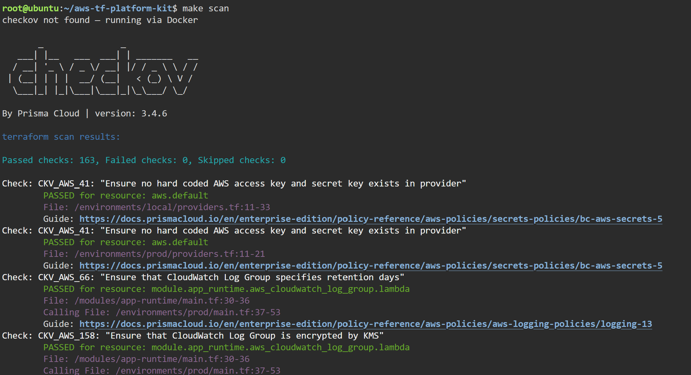
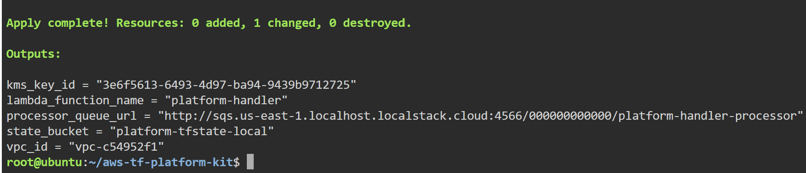
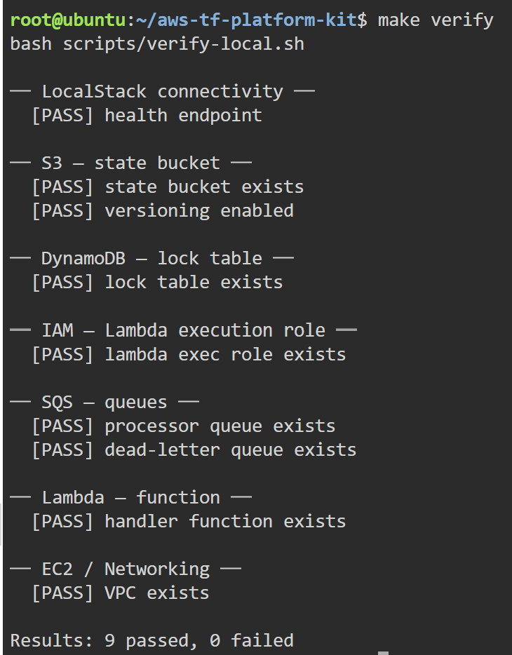

# aws-tf-platform-kit

A production-grade, modular Terraform repository for provisioning a hardened, multi-tier AWS platform. Supports 100% free local development and integration testing against [LocalStack Community](https://localstack.cloud/) (`3.8.1`, no auth token required).

## Architecture

```
┌─────────────────────────────────────────────────────────────┐
│                      AWS / LocalStack                        │
│                                                             │
│  ┌────────────┐   ┌────────────┐   ┌────────────────────┐  │
│  │ networking │   │security-iam│   │   storage-state    │  │
│  │            │   │            │   │                    │  │
│  │  VPC + IGW │   │ IAM roles  │   │  S3 + DynamoDB     │  │
│  │  Subnets   │   │ policies   │   │  (TF state backend)│  │
│  │  NACLs     │   │ KMS CMK    │   │                    │  │
│  │  Flow Logs │   │            │   └────────────────────┘  │
│  └────────────┘   └────────────┘                           │
│                                                             │
│  ┌─────────────────────────────────────────────────────┐   │
│  │                   app-runtime                       │   │
│  │                                                     │   │
│  │   Lambda (Python 3.12)  +  SQS (DLQ) + EventBridge  │   │
│  └─────────────────────────────────────────────────────┘   │
└─────────────────────────────────────────────────────────────┘
```

## Modules

| Module | Purpose |
|---|---|
| `networking` | VPC, restricted default SG, public/private subnets, IGW, NAT, NACLs, VPC Flow Logs |
| `security-iam` | Scoped IAM roles, least-privilege policies, customer-managed KMS CMK with rotation |
| `storage-state` | S3 state bucket (versioned, KMS-encrypted, public access blocked), DynamoDB lock table with PITR & TTL |
| `app-runtime` | Python 3.12 Lambda (VPC-attached, X-Ray tracing, code signing in prod), KMS-encrypted SQS + DLQ, EventBridge rule |

## Prerequisites

| Tool | Version | Notes |
|---|---|---|
| Terraform | >= 1.6.0 | Required |
| Docker | >= 24.0 | Required (mounts `/var/run/docker.sock` for local Lambda runtime) |
| Docker Compose | >= 2.0 | Optional — `Makefile` automatically falls back to `docker run` |
| Checkov | >= 3.0 | Optional — `make scan` automatically falls back to `bridgecrew/checkov` container |
| TFLint | >= 0.50 | Optional — `make lint` automatically falls back to `tflint` container |
| AWS CLI | >= 2.0 | Optional — `make verify` automatically falls back to `amazon/aws-cli` container |

## Quick Start — Local (LocalStack)

```bash
# Start LocalStack Community (pinned to 3.8.1)
make localstack-up

# Configure local variables, initialise, and apply
cp -n environments/local/terraform.tfvars.example environments/local/terraform.tfvars
make local-init
make local-apply

# Run the automated 9-point AWS API audit
make verify

# Tear down
make local-destroy
make localstack-down
```

## Quick Start — Production

```bash
cd environments/prod
cp terraform.tfvars.example terraform.tfvars
# Edit terraform.tfvars with your AWS account values

terraform init
terraform plan -out=tfplan
terraform apply tfplan
```

## CI / CD

- **GitHub Actions**: `.github/workflows/terraform.yml` — `fmt` → `validate` → `tflint` → `checkov` → `plan` on every push and PR.
- **GitLab CI**: `.gitlab-ci.yml` — equivalent multi-stage pipeline for GitLab.

## Makefile Targets

```
make help            Show all available targets
make localstack-up   Start LocalStack 3.8.1 (Docker Compose v2 or standalone Docker fallback)
make localstack-down Stop and remove LocalStack container and volumes
make local-init      terraform init (local env)
make local-plan      terraform plan (local env)
make local-apply     terraform apply (local env, auto-approve)
make local-destroy   terraform destroy (local env, auto-approve)
make fmt             terraform fmt -recursive
make validate        terraform validate across all environments and modules
make lint            Run tflint (native binary or Docker fallback)
make scan            Run Checkov static security scan (native binary or Docker fallback)
make verify          Run scripts/verify-local.sh end-to-end audit
make clean           Remove .terraform directories and cached plan files
```

## Security Posture

- **Encryption at rest**: Customer-managed KMS CMK (`enable_key_rotation = true`) encrypting S3 state, DynamoDB lock table, SQS queues, Lambda environment variables, and CloudWatch Log Groups.
- **Encryption in transit**: HTTPS-only (`aws:SecureTransport`) bucket and queue policies; TLS 1.2+ enforced on S3.
- **Least privilege**: Dedicated IAM execution roles per service with scoped resource ARNs and `aws:SourceAccount` / `kms:CallerAccount` conditions.
- **Network isolation**: Private subnets for compute; explicit NACL deny rules for management ports (`20`, `21`, `22`, `3389`); restricted VPC default security group; VPC Flow Logs to CloudWatch Logs.
- **Supply chain & state hardening**: S3 versioning, full Public Access Block, DynamoDB PITR + TTL locking, and AWS Signer Lambda code signing in production.
- **Static analysis**: `make scan` enforces Checkov compliance (**163 passed, 0 failed**, with `CKV_AWS_18` and `CKV2_AWS_62` documented and skipped for the Terraform state bucket).

## Verification & Proof of Work

### 1. Checkov Static Security Scan (`make scan`)


### 2. LocalStack Provisioning (`make local-apply`)


### 3. Live Infrastructure Audit (`make verify`)


## Repository Layout

```
aws-tf-platform-kit/
├── Makefile
├── docker-compose.yml
├── .gitignore
├── .tflint.hcl
├── .checkov.yaml
├── README.md
├── docs/images/
│   ├── checkov-security.png
│   ├── terraform-apply-local.png
│   └── verify-local-audit.png
├── scripts/verify-local.sh
├── modules/
│   ├── networking/
│   ├── security-iam/
│   ├── storage-state/
│   └── app-runtime/
├── environments/
│   ├── local/
│   └── prod/
├── .github/workflows/terraform.yml
└── .gitlab-ci.yml
```

## License

MIT